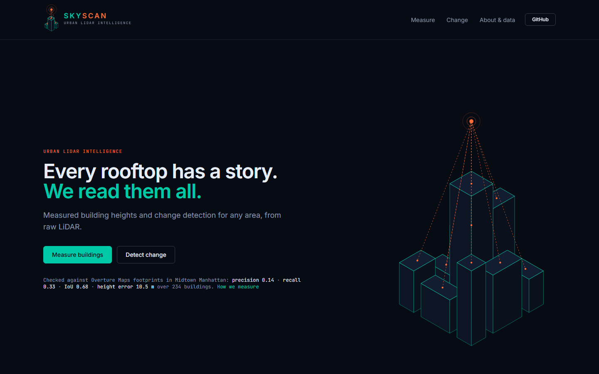
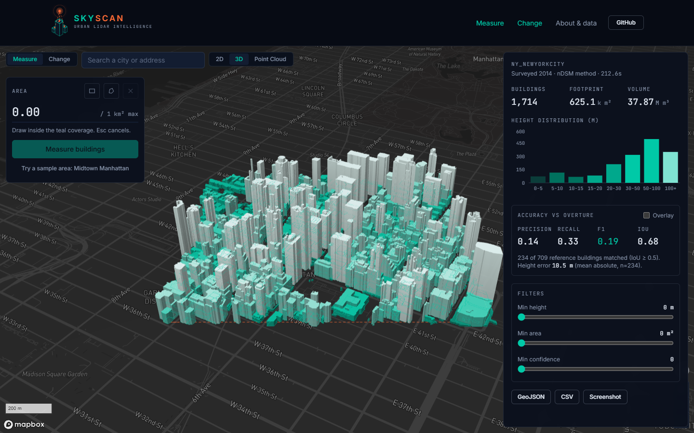
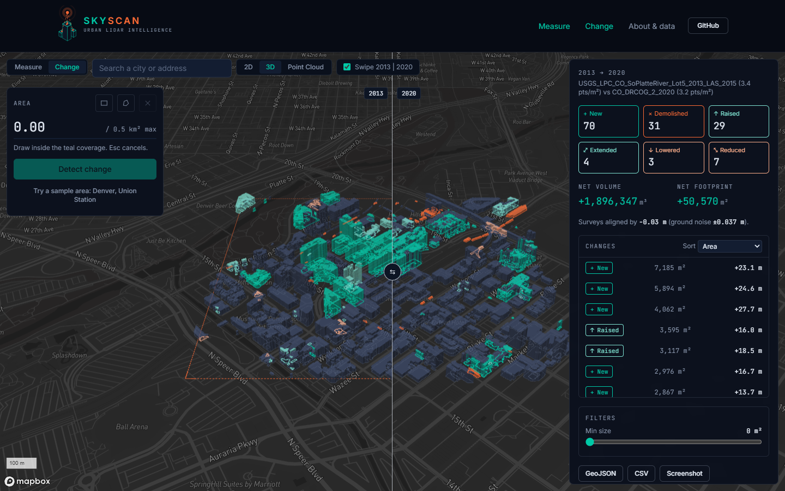
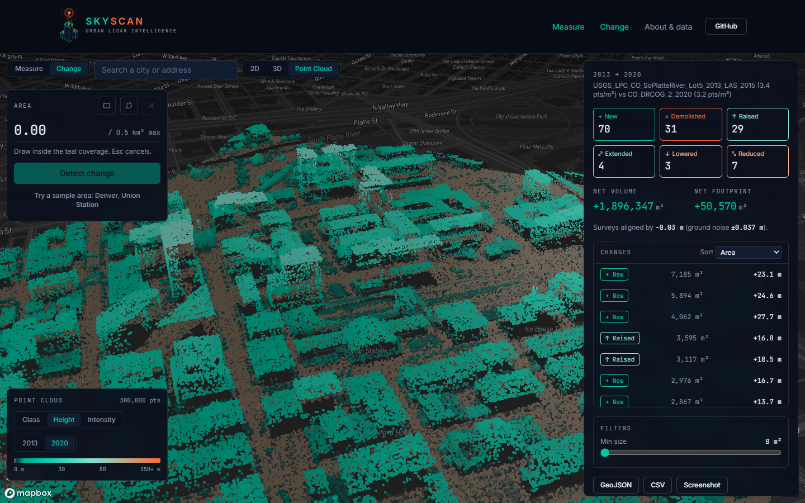
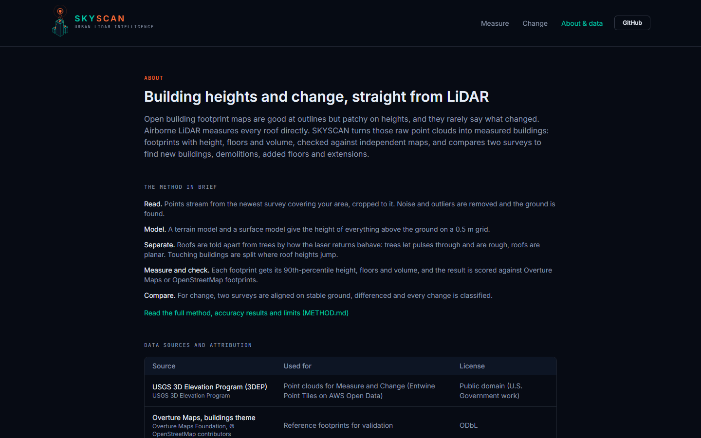
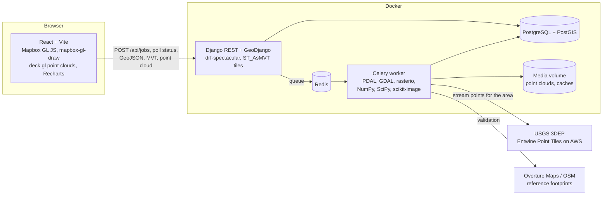

<p align="center">
  
</p>

# SKYSCAN · Urban LiDAR Intelligence

**Every rooftop has a story. We read them all.**
Measured building heights and change detection for any area, from raw LiDAR.

SKYSCAN does two things with free airborne LiDAR from the USGS 3D Elevation Program:

1. **Measure.** Draw an area of up to 1 km² and get building footprints with measured height, floors and
   volume in about a minute, with accuracy numbers you can check against independent maps.
2. **Change.** Compare two LiDAR surveys of the same area and flag new buildings, demolitions, added floors
   and extensions, with heights before and after.

**Who it is for:**
- Planners, GIS analysts and researchers who need building heights (open footprint data has patchy heights).
- City assessors and code enforcement staff who need to find what changed between surveys.

> **Demo:** a short GIF of a Measure run and the Denver change swipe goes here (`docs/screenshots/demo.gif`).

## What it looks like

**Measure:** 1,714 buildings in Midtown Manhattan, extruded by measured height, with the accuracy card.


**Change:** Denver's Railyards, 2013 | 2020 swipe. New buildings in teal, demolitions in orange.


**Point cloud:** the 2020 survey, coloured by height above ground.


| Landing | About and data |
|---|---|
|  |  |

## How it works



1. **Read.** PDAL streams only the points inside your area from the newest survey that covers it, drops
   noise and outliers, and finds the ground (survey class 2, or SMRF when there is none).
2. **Model.** A terrain model and a surface model on a shared 0.5 m grid give the height of everything
   above the ground.
3. **Separate.** Most 3DEP data has no building class, so roofs are told apart from trees by how the laser
   behaves: multi-return pulses, the depth of points below the top surface, and roughness. Touching buildings
   are split where roof heights jump and merged back where they are one building.
4. **Measure and check.** Each footprint gets its 90th-percentile height, floors, volume and a confidence.
   Every job is then scored against Overture Maps (or OpenStreetMap) footprints.
5. **Compare.** Change mode measures two surveys on the same grid, aligns them vertically on stable ground,
   differences them and classifies each change as new, demolished, raised, lowered, extended or reduced.

The full method, tuning history and limits are in [docs/METHOD.md](docs/METHOD.md).

## Accuracy

These numbers were computed by the validation code against Overture Maps footprints (release 2026-10-21.0),
matching one-to-one at IoU ≥ 0.5. Height error is the mean absolute difference where the reference has a height.

| Area | Survey | F1 | Mean IoU | Height error (buildings compared) |
|---|---|---|---|---|
| Seattle, Capitol Hill (houses, mature trees) | King County 2021 | 0.74 | 0.78 | 2.2 m (241) |
| Chicago, Lincoln Park (row houses, garages) | Cook County 2017 | 0.41 | 0.69 | 1.4 m (114) |
| New York, Midtown (towers, shared walls) | NYC 2014 | 0.22 | 0.68 | 10.0 m (46) |
| Measure showcase: Midtown, 1.1 km² (1,714 buildings) | NYC 2014 | 0.19 | 0.68 | 10.5 m (234) |

**Where it works well:** detached and semi-detached buildings, where outlines are unambiguous: F1 around
0.75 and heights within about 2 m.
**Where it struggles:** dense cores. Reference maps split blocks into one building per lot, but buildings
that share a wall and a roof height look like one roof in LiDAR, and towers with setbacks break into pieces.
Midtown's only survey is also from 2014, so newer buildings count as errors.

The Change showcase (Denver, Union Station, 2013 to 2020) finds 144 changes, among them 70 new and 31
demolished buildings, after aligning the two surveys by −3.3 cm on stable ground.

## Limits

- Heights are relative to the ground model; steep slopes inflate the downhill side.
- Dense evergreen street trees (seen in downtown Los Angeles) can look like roofs to every cue.
- Floors assume 3 m per floor.
- Change mode compares surveys of different density and season; the density ratio and vertical noise are
  shown with each result. Changes smaller than one floor (2.5 m) are not reported.
- Change detection has no independent reference yet, so no accuracy numbers are given for it.

## Run it

Requirements: Docker Desktop, Node 20+, and a free [Mapbox](https://account.mapbox.com/) public token.

```bash
cp backend/.env.example backend/.env
docker compose up --build
```

In a second terminal:

```bash
docker compose exec api python manage.py load_3dep_index
docker compose exec api python manage.py precompute_city midtown-manhattan
docker compose exec api python manage.py precompute_change denver-union-station
```

Then the frontend:

```bash
cd frontend
cp .env.example .env.local      # set VITE_MAPBOX_TOKEN
npm install
npm run dev                     # http://localhost:3000
```

API docs: http://localhost:8000/api/docs/

Command-line runs, without the frontend:

```bash
docker compose exec api python manage.py measure --bbox=-122.3175,47.6230,-122.3115,47.6270
docker compose exec api python manage.py detect_change --bbox=-105.0040,39.7520,-104.9970,39.7570
```

Tests:

```bash
docker compose exec api python manage.py test apps
cd frontend && npm test
```

Production: see [DEPLOY.md](DEPLOY.md).

## Project layout

```
Skyscan/
  frontend/            React app (Vite, Tailwind, Mapbox GL JS, deck.gl)
  backend/
    apps/
      cities/          showcase cities, datasets, coverage, precompute commands
      lidar/           source adapters (USGS EPT, local LAS), processing pipeline
      detection/       measure jobs, buildings, validation, exports, jobs API
      change/          change jobs and change features
      tiles/           MVT endpoints
  docs/
    METHOD.md          how detection, validation and change detection work
    DATA_SOURCES.md    LiDAR and reference sources, licenses, endpoint checks
  docker-compose.yml   dev stack: PostGIS, Redis, API, worker
  docker-compose.prod.yml
```

## Data and attribution

- LiDAR: **USGS 3D Elevation Program (3DEP)**, public domain, via the AWS Open Data `usgs-lidar-public` bucket.
- Reference footprints: **Overture Maps Foundation** and **© OpenStreetMap contributors** (ODbL).
- Basemap: **© Mapbox**.

More sources, including European LiDAR portals, are listed in [docs/DATA_SOURCES.md](docs/DATA_SOURCES.md).

---

SKYSCAN is a personal project by Aneeqa ([@aneeqa86](https://github.com/aneeqa86)).
